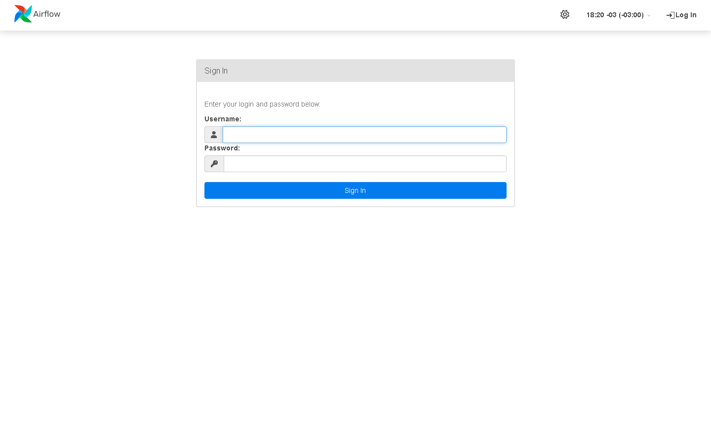
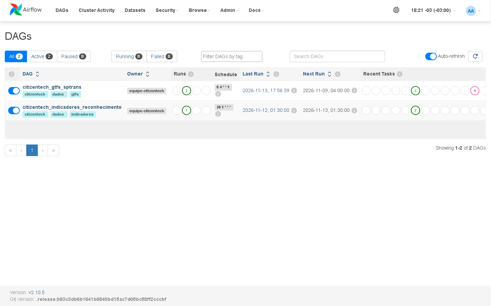
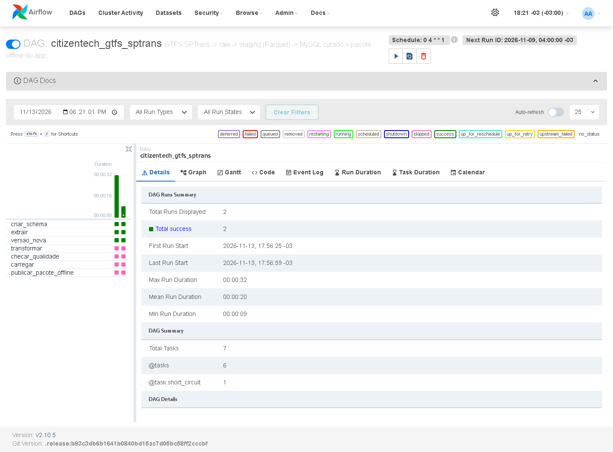
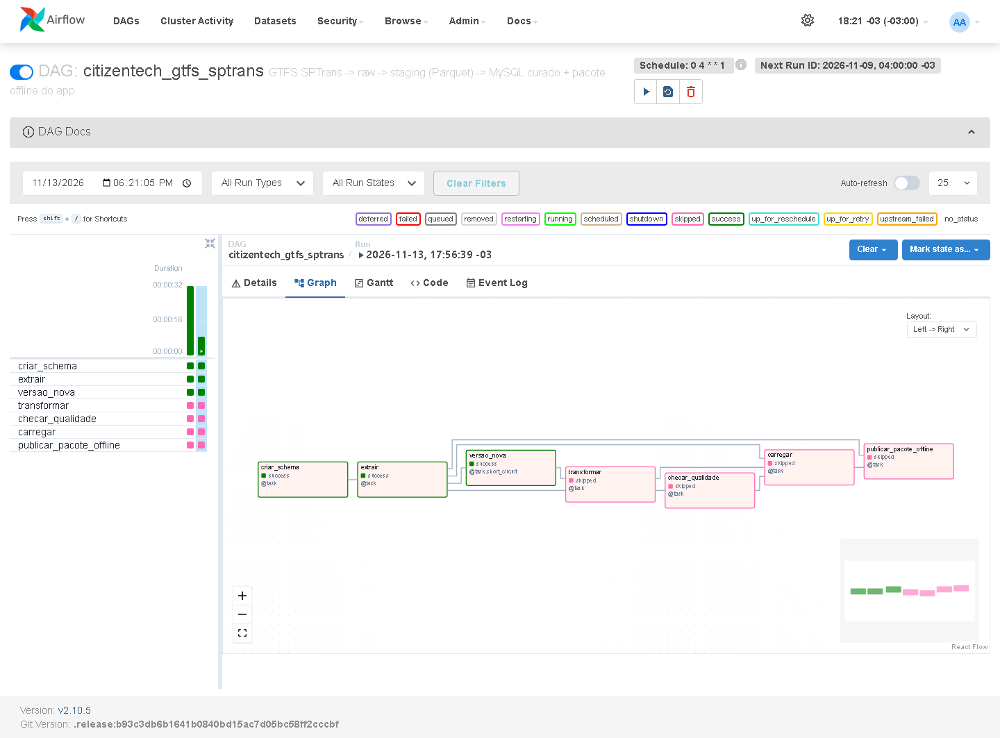
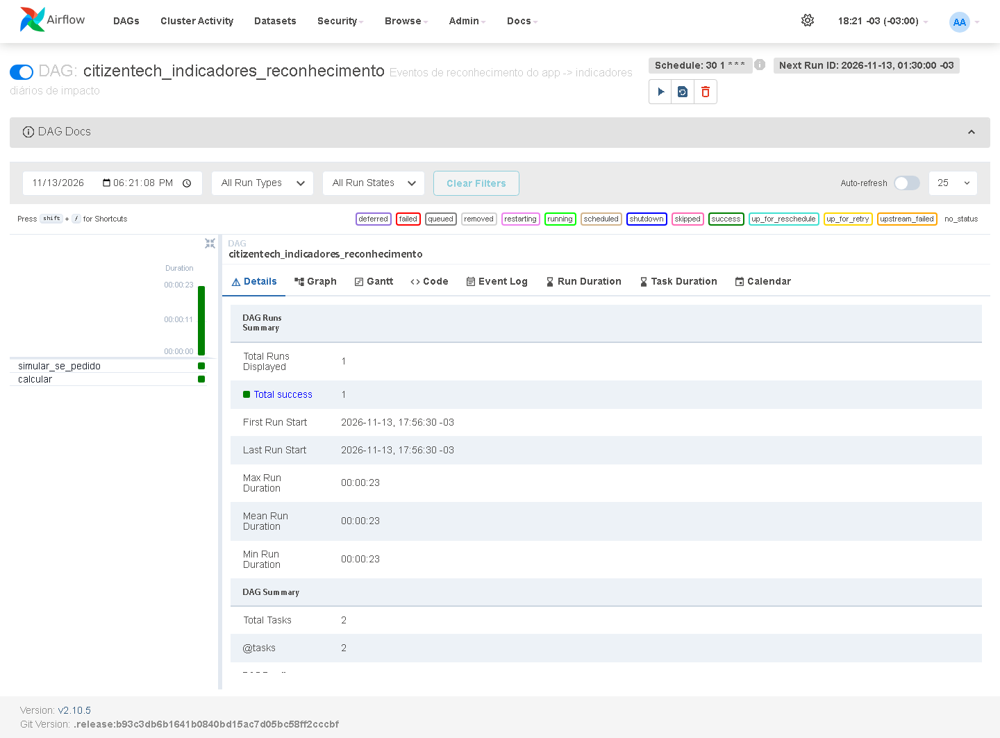
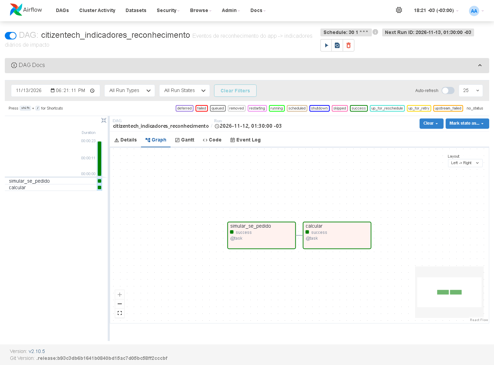
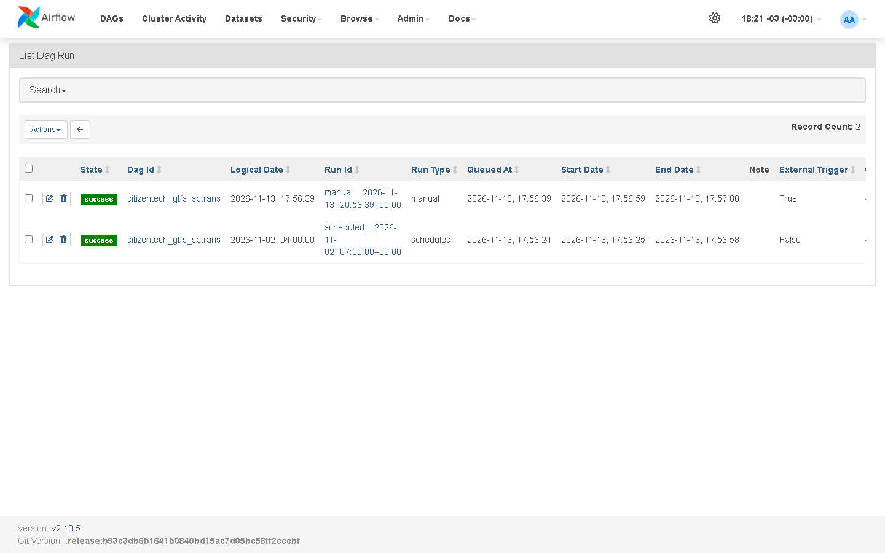
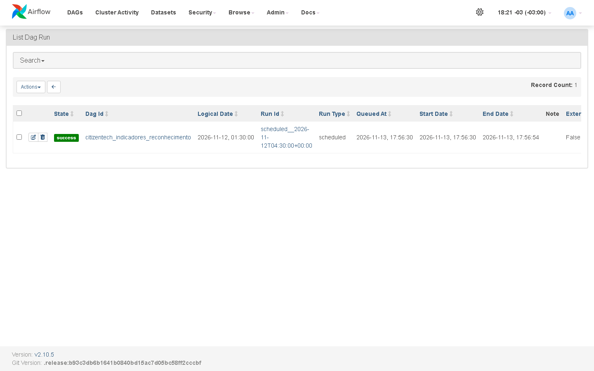
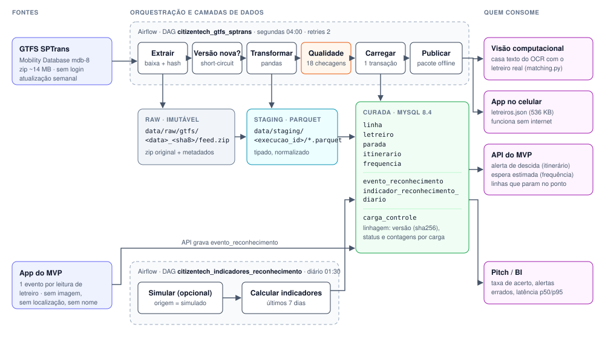

# CitizenTech · Componente Dados — Pipeline do Assistente de Mobilidade por Ônibus

**Global Solution 2026.2 · Engenharia de Software 4º ano · Big Data Architecture & Data Integration**

## 👥 Equipe

| Integrante | RM |
|---|---|
| Guilherme Santiago da Silva | RM552321 |
| Gustavo Govea Soares | RM553842 |
| Pedro Henrique Mello Silva Alves | RM554223 |
| Gabriel Borba | RM553187 |

---

## 🎯 Objetivo

Este repositório materializa o componente **"Dados"** do MVP da CitizenTech. O pipeline demonstra um fluxo funcional de dados do bruto ao curado, orquestrado por Apache Airflow, que alimenta os modelos de IA e a interface do assistente de mobilidade para pessoas cegas ou com baixa visão.

**Entregáveis principais:**
- ✅ **Pipeline funcional** — DAGs Airflow executando ETL/ELT de ponta a ponta
- ✅ **Arquitetura em camadas** — Raw → Staging (Parquet) → Curada (MySQL 8.4)
- ✅ **Dicionário de dados** — Todas as tabelas com tipos, chaves e exemplos
- ✅ **PDF de entrega** — [Diagrama de arquitetura + dicionário + evidências em um único arquivo](docs/Entrega_BigData_CitizenTech.pdf)
- ✅ **Prints do Airflow** — Evidências de execução exibidas abaixo

## 📎 Entrega

| Item | Link |
|---|---|
| Repositório | https://github.com/guicvsub/GS-2026 |
| PDF único (arquitetura + dicionário + evidências) | [`docs/Entrega_BigData_CitizenTech.pdf`](docs/Entrega_BigData_CitizenTech.pdf) |
| Prints do Airflow | [`docs/evidencias/prints_airflow/`](docs/evidencias/prints_airflow/) |
| Página navegável de evidências | [`docs/evidencias/evidencias_web.html`](docs/evidencias/evidencias_web.html) |

---

## 📂 O que contém este Repositório

```
dags/                       DAGs do Airflow (só orquestram; a lógica fica em pipeline/)
pipeline/
  extract.py               ingestão raw + sha256
  transform.py             GTFS → linha, letreiro, parada, itinerario, frequencia (Parquet)
  quality.py               portão de qualidade (18 checagens)
  load.py                  carga transacional + linhagem
  matching.py              contrato com a visão computacional (OCR → letreiro)
  metrics.py               DAG 2: indicadores de impacto
  simulacao.py             eventos simulados com premissas documentadas
  run_local.py             executor sem Airflow
sql/schema_mysql.sql        DDL gerado do schema
docs/                       arquitetura, dicionário, evidências, PDF de entrega
tests/                      testes com mini-GTFS sintético
```

---

## 🖼️ Prints do Airflow — Evidências de Execução

As imagens abaixo são exibidas **diretamente neste README** e comprovam o pipeline rodando de forma orquestrada no Apache Airflow 2.10.5. Cada print vem seguido da justificativa do que ele evidencia na entrega.

---

### DAG 1 — `citizentech_gtfs_sptrans` (GTFS SPTrans → MySQL)

#### 00 · Tela de login do Airflow



**Justificativa:** comprova que a interface web do Airflow está no ar em `localhost:8080` e protegida por autenticação. É o ponto de entrada do ambiente orquestrado usado em todas as demais evidências.

#### 01 · Visão geral dos DAGs



**Justificativa:** mostra os dois DAGs da entrega carregados e ativos no Airflow 2.10.5 — `citizentech_gtfs_sptrans` e `citizentech_indicadores_reconhecimento` —, ambos com execuções registradas, owner `equipe-citizentech` e agendamento configurado.

#### 02 · Grid da DAG 1 (histórico de execuções)



**Justificativa:** exibe o grid da DAG de ingestão GTFS e o estado de cada task do fluxo `criar_schema → extrair → versao_nova → transformar → checar_qualidade → carregar → publicar_pacote_offline`. Evidencia o pipeline completo e a atuação do short-circuit na reexecução.

#### 03 · Graph da DAG 1 (dependências)



**Justificativa:** apresenta o grafo de dependências da DAG 1. Na execução exibida, `criar_schema`, `extrair` e `versao_nova` concluíram, enquanto as etapas seguintes foram marcadas como *skipped* porque o SHA-256 do feed já estava carregado — prova visual da idempotência do pipeline.

### DAG 2 — `citizentech_indicadores_reconhecimento` (Eventos → Indicadores)

#### 04 · Grid da DAG 2



**Justificativa:** comprova a execução bem-sucedida da DAG de indicadores, com as tasks `simular_se_pedido` (parâmetro `simular: true`) e `calcular` concluídas. Valida a geração das métricas diárias de reconhecimento de letreiros a partir dos eventos do app.

#### 05 · Graph da DAG 2



**Justificativa:** mostra o fluxo `simular_se_pedido → calcular`, evidenciando a transformação de eventos brutos em indicadores de impacto: taxa de acerto, latência p50/p95 e desempenho no período noturno.

#### 06 · Histórico de execuções da DAG 1



**Justificativa:** lista os DAG runs da ingestão GTFS, ambos com estado `success`. A reexecução com o mesmo feed teve as etapas de transformação e carga ignoradas pelo short-circuit, sem duplicar dados. Confirma a linhagem registrada em `carga_controle` e o status `ignorada` documentado em `docs/evidencias/02_reexecucao_idempotente.log`.

#### 07 · Histórico de execuções da DAG 2



**Justificativa:** lista o DAG run agendado da DAG 2, comprovando a recorrência diária do cálculo dos indicadores e a reprodutibilidade do fluxo.

---

### 📁 Arquivos complementares da pasta `docs/evidencias/`

| Arquivo | Descrição |
|---|---|
| [`01_execucao_completa.log`](docs/evidencias/01_execucao_completa.log) | Log da execução completa: download do GTFS, gravação do Raw com SHA-256, contagens do staging, 18 checagens de qualidade aprovadas e carga transacional no MySQL. |
| [`02_reexecucao_idempotente.log`](docs/evidencias/02_reexecucao_idempotente.log) | Log da reexecução com o mesmo feed. Prova que a versão já carregada é detectada e a carga retorna `"status": "ignorada"`, sem duplicar registros. |
| [`03_consultas.txt`](docs/evidencias/03_consultas.txt) | Consultas SQL e resultados que comprovam a linhagem em `carga_controle`, o vocabulário de letreiros da linha 8000-10, o alerta de descida por itinerário e a espera estimada por frequência. |
| [`evidencias_web.html`](docs/evidencias/evidencias_web.html) | Versão navegável das evidências, com os oito prints e as justificativas em uma única página HTML. |
| [`prints_airflow/`](docs/evidencias/prints_airflow/) | Pasta com as oito capturas de tela do Airflow exibidas acima, além do HTML auxiliar `_login.html` salvo durante a captura. |

---

## 🏗️ Arquitetura em Camadas



- **Raw (imutável):** o zip original, identificado pelo SHA-256. Permite reprocessar sem baixar de novo.
- **Staging (Parquet):** tabelas tipadas e normalizadas por execução.
- **Curada (MySQL 8.4):** carga em **uma transação** com reconciliação staging × banco. Reexecutar com o mesmo feed **não duplica nada** (o DAG pula por short-circuit).
- **Entrega:** banco para a API + pacote offline para o app.

**18 checagens de qualidade** atuam como portão: se uma crítica falha, nada é carregado e o MVP segue com a última versão boa.

---

## 📚 Dicionário de Dados

Dicionário completo disponível em: [docs/dicionario_de_dados.md](docs/dicionario_de_dados.md)

Tabelas principais (contagens da última carga, sha256 `ae07f1c3…`):
- `linha` — 1.366 linhas de ônibus (route_id, número, nome, cor)
- `letreiro` — 2.269 letreiros (vocabulário do OCR)
- `parada` — 22.266 paradas com coordenadas (lat, lon)
- `itinerario` — 99.031 sequências de paradas por letreiro
- `frequencia` — 40.353 faixas horárias com intervalos
- `evento_reconhecimento` — 500 eventos de reconhecimento do app
- `indicador_reconhecimento_diario` — Indicadores diários de impacto
- `carga_controle` — Linhagem: versão do feed, status e contagens por carga

**DDL do MySQL:** [sql/schema_mysql.sql](sql/schema_mysql.sql)

---

## ▶️ Como Executar o Pipeline

### Opção A — Airflow com Docker (recomendado)

```bash
cp .env.example .env          # troque as senhas
docker compose up -d --build  # sobe MySQL, Postgres, Airflow webserver e scheduler
```

1. Acesse http://localhost:8080 com as credenciais de `AIRFLOW_ADMIN_USER` / `AIRFLOW_ADMIN_PASSWORD` definidas no `.env` (as evidências usaram `admin` / `admin_local`)
2. Dispare `citizentech_gtfs_sptrans` (▶ Trigger DAG)
3. Dispare `citizentech_indicadores_reconhecimento` com `{"simular": true}`
4. Dados disponíveis no MySQL (porta 3306 em 127.0.0.1)

### Opção B — Sem Docker (banco SQLite local)

```bash
python -m venv .venv
.venv\Scripts\pip install -r requirements.txt
.venv\Scripts\python -m pipeline.run_local tudo      # GTFS + simulação + indicadores
.venv\Scripts\python -m pipeline.run_local gtfs      # reexecução: status "ignorada" (idempotente)
.venv\Scripts\python -m pytest tests -q              # 10 testes
.venv\Scripts\python -m scripts.gerar_documentacao    # dicionário + consultas
.venv\Scripts\python -m scripts.gerar_pdf             # PDF único de entrega
```

### Opção C — GitHub Actions

O workflow fica na **raiz do repositório** (`.github/workflows/pipeline.yml`, exigência do GitHub Actions) e roda a cada push que altere este projeto: testes, carga dos DAGs no Airflow 2.10.5, `airflow dags test`, reexecução para provar idempotência e conferência de contagens no MySQL 8.4. Logs e `letreiros.json` ficam como artefato `evidencias-pipeline`.

---

## 📦 Dados: Origem, Licença e Decisões

- **GTFS SPTrans** — via espelho público do [Mobility Database](https://mobilitydatabase.org) (`mdb-8`), sem cadastro necessário. Última versão carregada: sha256 `ae07f1c3…` (13/11/2026). A versão anterior (`457293b8…`) também está documentada nos logs de evidência.
- **Eventos simulados** — Enquanto não há testes de campo, o DAG 2 gera eventos marcados `origem = 'simulado'` com premissas documentadas em `pipeline/simulacao.py`. **Não são resultados medidos do produto.**
- **Tempo real (Olho Vivo)** — Não está no MVP; exige token e não é necessário para o fluxo central.
- **shapes.txt (60 MB)** — Fica apenas no Raw; o app não desenha o traçado, só precisa da sequência de paradas.

---
